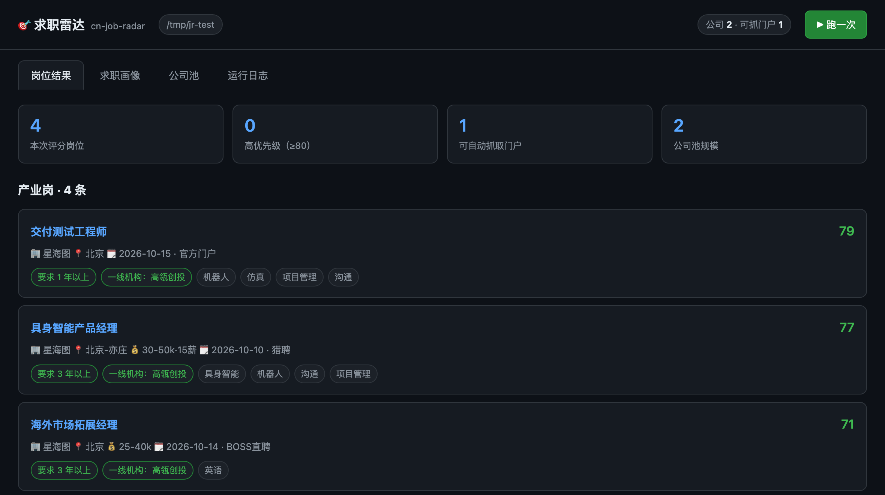

<div align="center">

# 🎯 cn-job-radar · 求职雷达

**盯公司官方招聘门户，而不是招聘平台。**
把每一家在招岗位按你的画像自动打分排序。

[](https://www.python.org/)
[](LICENSE)
[](#隐私)

[English](README.md) · [简体中文](README.zh-CN.md)

</div>

---

## 为什么还要再造一个求职工具

GitHub 上的开源求职项目，几乎全部盯着**欧美招聘平台** —— LinkedIn、Indeed、Greenhouse、Lever、Workday。**没有一个懂飞书招聘、Moka、北森** —— 而这三套系统才是中国科技公司真正在用的。

`cn-job-radar` 走的是另一条路：

| | JobSpy / career-ops / AIHawk | **cn-job-radar** |
|---|---|---|
| 岗位从哪来 | LinkedIn、Indeed 等聚合平台 | **企业自己的招聘门户**（飞书招聘 · Moka · 北森） |
| 要不要登录 | 经常要 | **完全不用** |
| 反爬 | 长期猫鼠游戏 | **不存在** —— 这些是公开接口 |
| 怎么匹配 | 用大模型读简历打分 | **六维确定性打分，权重自己调** |
| 数据 | 上传到云端 | **只在本地** |
| 适用 | 欧美市场 | **中国（以及任何用 ATS 的公司）** |

读企业自己的门户，意味着你能在**岗位挂出的当天**看到它 —— 比聚合平台更快，而且永远不用跟验证码较劲。

---

## 快速开始

```bash
pip install cn-job-radar      # 或 pip install -e .

radar init                    # 交互式：选行业、城市、岗位轨道
radar setup                   # 一次性：安装抓取引擎
radar run                     # 抓取 → 打分 → 出日报
radar ui                      # 可选：打开本地 Web 界面
```

报告输出到 `~/.cn-job-radar/reports/`。

> 想先随便试试？`radar init --industry ai --cities 北京 --yes` 跳过所有提问。



<sub>本地 Web 界面（`radar ui`）。每个分数都能拆开 —— 卡片下方那条色带就是六个维度，哪一段没占满，分就是丢在那里。</sub>

---

## 它是怎么工作的

```
                 ┌──────────────────────────────────────────┐
                 │  公司池（companies.yaml）                 │
                 │  「系统只看得见你名单里的公司」            │
                 └────────────────┬─────────────────────────┘
                                  │
        ┌─────────────────────────┼─────────────────────────┐
        ▼                         ▼                         ▼
    飞书招聘                    Moka                       北森
  xxx.jobs.feishu.cn   app.mokahr.com/apply/…     xxx.zhiye.com
        └─────────────────────────┼─────────────────────────┘
                                  ▼
                  统一字段（岗位名／地点／薪资／JD／链接）
                                  ▼
                    ┌──────────────────────────┐
                    │      六维打分引擎         │
                    └──────────────────────────┘
                                  ▼
                 Markdown + HTML 日报 · JSON · Web 界面
```

### 公司池就是全部

系统**只看得见你名单里的公司**。这是刻意的设计：与其全网乱抓一堆不相关的岗位，不如维护一份高质量名单。**加一家公司 = 永久多盯一家。**

加公司就是一段 YAML，不用改代码：

```yaml
- id: galbot
  name: 银河通用
  city: 北京
  tracks: [人形机器人]
  funding: {latest_round: 战略轮, amount: 25亿元, date: "2026-03-02", lead: [国家人工智能产业投资基金]}
  tier1_backers: [美团龙珠, 经纬创投, 蓝驰创投]
  portal: {type: feishu, arg: "owm6ymi5v9b.jobs.feishu.cn/870797"}
```

### 六维打分

```
岗位匹配    15  ─ 命中 strong 档关键词 100 分；只命中 normal 档 68 分
公司/机构质量 22  ─ 产业岗看融资背书 + 融资新鲜度；投资岗看机构 tier
背景契合    20  ─ JD 命中你的加分词越多越高（15 个封顶），命中缺口词倒扣
经验门槛    28  ─ ★ 权重最高：从 JD 里读出「X 年以上」，门槛越低分越高
新鲜度       5  ─ 7 天内 100 分，一年以上 15 分
城市        10  ─ 目标城市 100；「目标+其他城市」78；外地 20
```

**为什么「经验门槛」权重最高。** 多数求职工具是为**资深候选人**设计的。但很多人 —— 转行的、重返职场的、应届的 —— 什么技术岗都愿意干，只是过不了「5 年以上」那道线。所以 `cn-job-radar` 不用黑名单去拦，而是**从 JD 里读出真实年限要求，让门槛低的岗位自己浮上来**。要求博士的沉底，「1 年以上，交付工程师」上升。一套机制解决三件事：你想做的工作不会被误杀、资深岗不会占满榜单、你永远不用维护黑名单。

### 两条轨道，两套算法

| | 产业岗轨道 | 投资岗轨道 |
|---|---|---|
| 质量看什么 | **公司**：融资轮次、金额、一线机构背书 | **机构**：tier、管理规模、赛道案例 |
| 岗位从哪来 | 企业官方门户 | BOSS 直聘 / 猎聘（官方门户上没有） |

一线市场化 VC 的得分高于国资平台 —— 这是一个**可修改的判断**：前者用行业研究、建模、案例答辩来考核，更奖励"用作品说话"。不同意就直接改 `tier` 数值。

---

## 内置行业包

用 `radar init` 勾选，可多选。

| id | 行业 |
|---|---|
| `ai` | 人工智能 · 大模型 |
| `robotics` | 机器人 · 具身智能 |
| `semiconductor` | 半导体 · 芯片 |
| `biotech` | 生物医药 · 医疗健康 |
| `newenergy` | 新能源 · 储能 · 电池 |
| `autotech` | 智能汽车 · 自动驾驶 |
| `finance` | 金融 · 投资 · 量化 |
| `general` | 通用（任意行业） |

每个包预置了岗位关键词、该赛道的活跃投资机构、行业识别信号。想改？把同名文件丢到 `~/.cn-job-radar/config/industries/` 就能覆盖内置版本。

---

## 命令

```bash
radar init [--industry ai,robotics] [--cities 北京 上海] [--yes]
radar setup                  # 安装抓取引擎
radar run [--no-fetch] [--track industry] [--ingest FILE]
radar stats                  # 公司池状况 + 哪些公司还没有门户
radar discover [--slugs a,b] # 探测招聘门户
radar ui [--port 8787]       # 本地 Web 界面
radar industries             # 列出行业包
```

### 从任何地方补岗位

企业门户覆盖不到所有岗位。你在别处找到的 —— BOSS 直聘、猎聘、公众号 —— 丢进 `data/raw/*.json` 就会一起参与打分：

```json
[{"title": "投资经理", "company": "君联资本", "location": "北京-海淀",
  "salary": "30-60k·18薪", "posted": "2026-10-14",
  "url": "https://…", "source": "猎聘", "jd": "岗位职责…任职要求…"}]
```

这也是和 AI agent 配合的方式：**让 agent 去浏览，让 cn-job-radar 来打分。**

---

## 隐私

全部在本地跑。岗位直接从公开的招聘门户接口读取；你的画像、公司池、结果都不离开这台机器。无需账号、无埋点、不上传。

工具**只读公开的岗位信息**：不碰简历、不登录任何站点、遇到验证码或登录墙就停下。

---

## 常见问题

**需要 API key 吗？** 不需要。

**在中国以外能用吗？** 打分、公司池、Web 界面都与市场无关；引擎除了支持中国这三套系统，还支持 24 个国际 ATS（Greenhouse、Lever、Ashby、Workday 等）。只有内置行业包偏中国。

**门户返回 0 个岗位，是坏了吗？** 不一定 —— 公司可能真的暂停招聘了。工具会区分「真没岗位」和「抓取失败」，并在状态**变化**时提醒你。

**为什么有的岗位没有薪资？** 飞书招聘的接口不返回薪资。不是 bug。

**想加的公司没有门户怎么办？** 跑 `radar discover`，或者去公司官网的「加入我们」页面找跳转链接，写进 `portals.yaml`。中国 ATS 门户有规律：北森是 `<英文名>.zhiye.com`；飞书招聘用的是随机串，只能搜。BOSS 直聘的公司页在程序访问时会返回反爬壳页，**不算验证通过**。

---

## 参与贡献

最有价值的贡献是**新公司及其招聘入口** —— 尤其是用飞书招聘 / Moka / 北森的中国公司。可以给 `radar/industries/*.yaml` 提 PR（关键词、投资机构），或者分享一段 `portals.yaml`。

也欢迎：新的行业包、本地化打分调整、真实求职过程中发现的 bug。

---

## 致谢

抓取引擎由 [Hiring-Radar](https://github.com/simonlin1212/Hiring-Radar)（MIT）提供，由 `radar setup` 按需拉取，不随仓库分发。

## 许可

MIT — 见 [LICENSE](LICENSE)。
